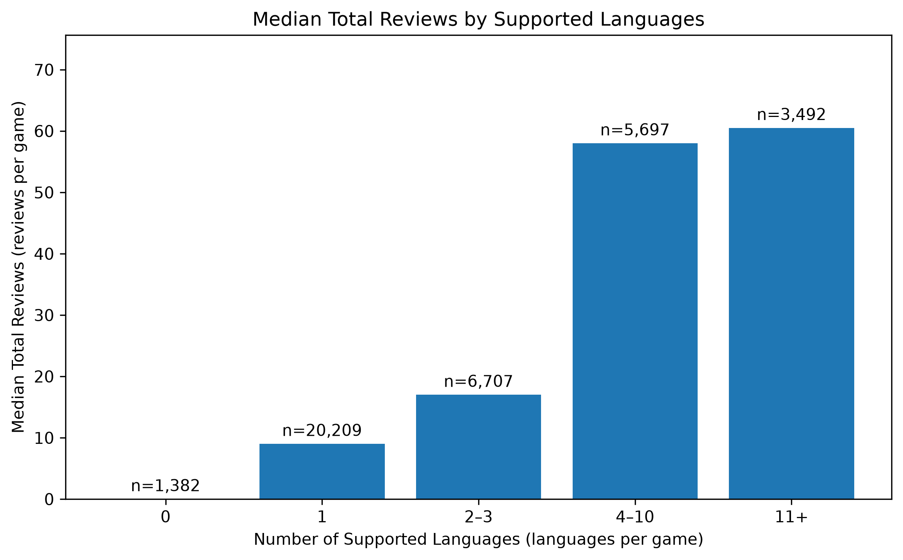

# Summary

This project investigates how well game characteristics can predict the total number of reviews received by Steam games released between 2018 and 2022. Using the Steam Games Dataset, we explore relationships between review counts and game features, including price, genres, categories, number of supported languages, and release date.

We conduct exploratory data analysis to examine review distributions and feature relationships, followed by regression modeling to evaluate predictive performance.

The goal is to better understand which game characteristics are associated with player engagement, using review counts as a measurable indicator.


# Introduction


The video game industry has become a major part of the digital entertainment market, with online platforms such as Steam providing developers and publishers access to a global audience. In addition to purchasing and playing games, Steam users can share their experiences and recommend games through reviews (Valve, n.d.). These reviews provide insights into player opinions and serve as a measurable indicator of audience engagement.

Understanding the factors associated with review volume is important for game developers and publishers because reviews can provide insights into player engagement and a game's visibility among potential players. Previous research has examined the relationship between online reviews and video game usage, as well as how different player engagement modes influence review characteristics (Philp & Nepomuceno, 2024; Guzsvinecz & Szűcs, 2026). Research on the Steam platform has also investigated game reviews and their relationship with game characteristics (Lin et al., 2019). Characteristics such as price, genres, available features, language support, and release timing may be associated with differences in the number of reviews received. Examining these relationships may help developers and publishers better understand which game characteristics are associated with greater audience engagement.

This study investigates the following research question: How well can selected game characteristics predict the total number of reviews received by Steam games released between 2018 and 2022? Specifically, the analysis examines five groups of explanatory variables: game price, number of supported languages, release date, genres, and Steam categories. Total review count, calculated by adding positive and negative reviews, is used as the response variable.

The analysis uses the Steam Games Dataset published by FronkonGames on Hugging Face (FronkonGames, n.d.). Each row represents an individual Steam game, with information including release date, price, genres, categories, language support, and positive and negative review counts. The study focuses on 46,859 games released between 2018 and 2022. The dataset is randomly divided into training and test sets, with 80% of the data used for exploratory data analysis and model development and the remaining 20% reserved for final model evaluation.

To investigate the research question, we first conduct exploratory data analysis to examine the distribution of review counts and explore their associations with selected game characteristics. We then develop a linear regression model to predict the logarithm of total review counts and compare its performance with a baseline model that predicts the mean. Model performance is evaluated using five-fold cross-validation on the training set and a held-out test set.

This study aims to evaluate the predictive value of selected game characteristics rather than establish causal relationships. By examining both feature associations and predictive performance, the analysis provides insights into how well game metadata can explain and predict differences in review volume, while highlighting the limitations of using these characteristics alone to estimate player engagement.

# Methods

## Data

We used the cleaned and pre-split data produced by `scripts/process_data.py`: 46,859 Steam games released between 2018 and 2022, randomly split 80/20 into training and test sets (seed 1234). Only the training set is used for model building and selection; the test set is used once, at the end, to report final performance.

```{python}
import pandas as pd

train = pd.read_csv ("../data/processed/train.csv")

train.shape
```


## Target variable

We predict `log1p(total_reviews)`, the log of reviews + 1. Logrthmicly transforming prevents the few very popular games from dominating the model. Adding 1 to the value keeps games with zero reviews defined.

```{python}
import numpy as np

X_train = train.drop(columns=["total_reviews"])
y_train = np.log1p(train["total_reviews"])
```

## Features

We used five groups of features, all built from the training data:

- **Price** in USD, used as is.
- **Number of supported languages**, capped at 10, since adding languages beyond that point makes little further difference.
- **Release day**: days since 1 January 2018, so the model can pick up trends over the 2018–2022 period.
- **Genres** and **categories**: one yes/no column per genre and per Steam category. Only levels that appear in at least 1% of training games are kept, so rare labels do not add noise. `Steam Trading Cards` is excluded because Valve grants it to games that already sell well, making it a consequence of popularity rather than a cause.

`appID` and `name` are identifiers and are not used as features.

### Transformation
```{python}
# Transform the data to fit contract. Clip number of languages to a max of 10, and calculate release day.
X_train["n_languages"] = X_train["n_languages"].clip(upper=10)
X_train["release_day"] = (pd.to_datetime(X_train["release_date"]) - pd.Timestamp("2018-01-01")).dt.days
```

### Preprocessing
```{python}
from sklearn.compose import ColumnTransformer
from sklearn.feature_extraction.text import CountVectorizer
from sklearn.preprocessing import StandardScaler

list_encoder = CountVectorizer(
    token_pattern=r'"([^"]+)"', # This keeps multi word labels
    lowercase=False,
    binary=True,
    min_df=0.01,
    stop_words=["Steam Trading Cards"],
)

preprocessor = ColumnTransformer([
    ("numeric", StandardScaler(), ["price", "n_languages", "release_day"]),
    ("genre", list_encoder, "genres"),
    ("category", list_encoder, "categories"),
])
```

## Model and evaluation

We fit a linear regression, with the preprocessing and model combined in one pipeline. We compare it to a baseline that always predicts the mean.

Both models are scored with 5-fold cross-validation on the training set. Because preprocessing is inside the pipeline, it is re-fit on each fold, so the validation data never influences it.

Our main metric is RMSE on the `log1p` scale, which measures relative error so that a few very popular games do not dominate. We also report MAE and R².


```{python}
from sklearn.dummy import DummyRegressor
from sklearn.linear_model import LinearRegression
from sklearn.model_selection import cross_validate
from sklearn.pipeline import make_pipeline

pipe = make_pipeline(preprocessor, LinearRegression())

models = {
    "Baseline (mean)": DummyRegressor(),
    "Linear regression": pipe,
}

scoring = {
    "RMSE": "neg_root_mean_squared_error",
    "MAE": "neg_mean_absolute_error",
    "R²": "r2",
}

cv_results = {}
for name, model in models.items():
    scores = cross_validate(model, X_train, y_train, cv=5, scoring=scoring)
    cv_results[name] = {
        "RMSE": -scores["test_RMSE"].mean(),
        "MAE": -scores["test_MAE"].mean(),
        "R²": scores["test_R²"].mean(),
    }

cv_results = pd.DataFrame(cv_results).T.round(3)

```

# Results
## Exploratory Data Analysis

### Summary Statistics

The training dataset contains 37,487 Steam games.
Descriptive statistics for the numerical variables
are presented in @tbl-training-summary.

```{python}
#| label: tbl-training-summary
#| tbl-cap: "Descriptive statistics of the training dataset"
#| echo: false

import pandas as pd

summary = pd.read_csv(
    "tables/training_summary.csv"
)

from IPython.display import display

display(
    summary.round(2)
)
```

The mean number of reviews (1,158.54) is substantially
higher than the median (14), indicating a strongly
right-skewed distribution.
This motivates the log transformation used in the
exploratory visualization.

The exploratory data analysis was conducted using only the training dataset to avoid data leakage.

### Distribution of Total Reviews

{#fig-review-distribution}

The distribution of total reviews is highly right-skewed. Most games receive relatively few reviews, while a small number of games receive substantially more. Applying the log transformation makes the distribution easier to visualize while retaining games with zero reviews.

### Supported Languages and Review Counts

{#fig-language-reviews}

Games supporting more languages tend to have higher median review counts. This suggests a positive association between language availability and review volume. However, this relationship is descriptive and does not establish causality.

## Model performance

After cross-validation, we fit the linear regression on the full training set and scored it once on the test set.

```{python}
from sklearn.metrics import root_mean_squared_error, mean_absolute_error, r2_score

pipe.fit(X_train, y_train)

# Read and transform test data in same way as training data was
test = pd.read_csv("../data/processed/test.csv")
X_test = test.drop(columns=["total_reviews"])
y_test = np.log1p(test["total_reviews"])
X_test["n_languages"] = X_test["n_languages"].clip(upper=10)
X_test["release_day"] = (pd.to_datetime(X_test["release_date"]) - pd.Timestamp("2018-01-01")).dt.days

y_pred = pipe.predict(X_test)

test_results = pd.DataFrame({
    "RMSE": [root_mean_squared_error(y_test, y_pred)],
    "MAE": [mean_absolute_error(y_test, y_pred)],
    "R²": [r2_score(y_test, y_pred)],
}, index=["Linear regression"]).round(3)

# Numbers quoted in the text below
cv_base = cv_results.loc["Baseline (mean)"]
cv_lr = cv_results.loc["Linear regression"]
test_lr = test_results.loc["Linear regression"]
error_factor = np.exp(test_lr["MAE"])  # MAE on the log scale -> multiplicative error
```

```{python}
#| label: tbl-performance
pd.concat(
    {"Cross-validation": cv_results, "Test set": test_results},
    names=["Evaluated on", "Model"],
) + 0.0  # turns the baseline's rounded R² of -0.000 into 0.000
```

Linear regression beats the mean baseline on every metric (@tbl-performance). In cross-validation it lowers RMSE from `{python} f"{cv_base['RMSE']:.2f}"` to `{python} f"{cv_lr['RMSE']:.2f}"` and explains `{python} f"{cv_lr['R²']:.0%}"` of the variance in log reviews, while the baseline explains none. The improvements are their but the model only explains some of the variance. The features Price, number of languages, release day, genres and categories together account for about a third of the variation in how many reviews a game gets. This indicates that there are features out there that explain more of that variance that was not trained in the model. 

The train test gap are very close together (RMSE `{python} f"{test_lr['RMSE']:.2f}"` vs `{python} f"{cv_lr['RMSE']:.2f}"`; R² `{python} f"{test_lr['R²']:.2f}"` vs `{python} f"{cv_lr['R²']:.2f}"`). This means the model is not overfitting and should perform about as well on other Steam games released in 2018 - 2022. In practical terms, the test MAE is `{python} f"{test_lr['MAE']:.2f}"` on the log scale. Because the model predicts $\log(1 + y)$, a gap of $d$ between the actual count $y$ and the predicted count $\hat{y}$ on the log scale is a ratio of $e^{d}$ on the original scale:

$$
\log(1 + y) - \log(1 + \hat{y}) = d
\quad \Longleftrightarrow \quad
\frac{1 + y}{1 + \hat{y}} = e^{d}
$$

Setting $d$ to the MAE gives $e^{\text{MAE}} \approx$ `{python} f"{error_factor:.1f}"`, so a typical prediction is off by a factor of about `{python} f"{error_factor:.1f}"` in either direction. For example, a game predicted to receive 100 reviews would typically end up with somewhere between `{python} round(100 / float(error_factor))` and `{python} round(100 * float(error_factor))`.

## Prediction accuracy by game popularity

### Visualization Code:

```{python}
#| code-fold: true
import altair as alt

# > Citation Claude Opus 5.5 was used for this visualization

# Group test games by their actual number of reviews.
# Groups are about half a power of ten wide, so they are evenly spaced on a log scale.
edges = [-1, 0, 3, 10, 30, 100, 300, 1000, 3000, np.inf]
review_group = pd.cut(
    test["total_reviews"],
    bins=edges,
    labels=["0", "1–3", "4–10", "11–30", "31–100", "101–300", "301–1,000", "1,001–3,000", "3,001+"],
)

predictions = pd.DataFrame({
    "group": review_group,
    "actual": test["total_reviews"],
    "predicted": np.expm1(y_pred),  # back to review counts
})

group_summary = predictions.groupby("group", observed=True).agg(
    games=("actual", "size"),
    actual=("actual", "median"),
    predicted=("predicted", "median"),
    predicted_low=("predicted", lambda p: p.quantile(0.25)),
    predicted_high=("predicted", lambda p: p.quantile(0.75)),
)

# Numbers quoted in the text below
lowest = group_summary.iloc[0]
highest = group_summary.iloc[-1]

#| code-fold: true
alt.data_transformers.disable_max_rows()  # plot every test game (Altair's default limit is 5,000 rows)

# One shared scale for every review axis, so the two panels line up.
# symlog's default ticks bunch at the top, so place them at powers of ten.
max_reviews = predictions[["actual", "predicted"]].max().max()
scale = alt.Scale(type="symlog", domain=[0, max_reviews])
axis = alt.Axis(values=[0, 1, 10, 100, 1_000, 10_000, 100_000, 1_000_000],
                labelExpr="format(datum.value, ',')")

# (A) Every game, with the perfect-prediction line and the group boundaries
scatter = alt.Chart(predictions[["actual", "predicted"]]).mark_circle(
    size=8, opacity=0.15, color="#1f77b4"
).encode(
    x=alt.X("actual", scale=scale, axis=axis, title="Actual reviews"),
    y=alt.Y("predicted", scale=scale, axis=axis, title="Predicted reviews"),
)
perfect = alt.Chart(pd.DataFrame({"reviews": [0, max_reviews]})).mark_line(
    color="black", strokeDash=[4, 4]
).encode(
    x=alt.X("reviews", scale=scale),
    y=alt.Y("reviews", scale=scale),
)
boundaries = alt.Chart(pd.DataFrame({"edge": [e + 0.5 for e in edges[1:-1]]})).mark_rule(
    color="grey", opacity=0.4
).encode(x=alt.X("edge", scale=scale))

panel_a = (boundaries + scatter + perfect).properties(
    width=300, height=300, title="A. Every test game"
)

# (B) Group medians, with the middle 50% of predictions
summary = group_summary.reset_index()
summary["group"] = summary["group"].astype(str)
medians = summary.melt(
    id_vars=["group", "games"], value_vars=["actual", "predicted"],
    var_name="type", value_name="reviews",
)
medians["type"] = medians["type"].str.capitalize()

x_group = alt.X("group", sort=None, title="Actual reviews (grouped)", axis=alt.Axis(labelAngle=-45))
spread = alt.Chart(summary).mark_rule(strokeWidth=3, opacity=0.4, color="#1f77b4").encode(
    x=x_group,
    y=alt.Y("predicted_low", scale=scale, axis=axis, title="Number of reviews"),
    y2="predicted_high",
)
dots = alt.Chart(medians).mark_point(filled=True, size=60, opacity=1).encode(
    x=x_group,
    y=alt.Y("reviews", scale=scale, axis=axis),
    color=alt.Color("type", title=None,
                    scale=alt.Scale(domain=["Actual", "Predicted"], range=["black", "#1f77b4"])),
    tooltip=[
        "group", "type",
        alt.Tooltip("reviews", format=",.0f", title="Median reviews"),
        alt.Tooltip("games", format=",", title="Games in group"),
    ],
)

panel_b = (spread + dots).properties(width=300, height=300, title="B. Grouped by actual reviews")

fig_groups = (panel_a | panel_b).resolve_scale(y="shared")
```

```{python}
#| label: fig-prediction-accuracy
#| fig-cap: "Predicted versus actual review counts for test-set games. (A) Every test game, with the dashed line marking perfect prediction and grey lines marking group boundaries. (B) Median actual and predicted review counts within each group of actual reviews; vertical bars show the middle 50% of predictions."
fig_groups
```

@fig-prediction-accuracy compares predicted and actual review counts for the `{python} f"{len(test):,}"` test games in two ways. Panel A plots every game. If the model were perfect, every point would sit on the dashed line. The cloud is clearly flatter than the line, but it is hard to read beyond that. With this many games the points overlap heavily. Review counts are also whole numbers, so games with few reviews pile up in vertical stripes at 0, 1, 2 and so on. From panel A alone it is hard to tell where most games lie or what a typical prediction looks like at a given level of popularity.

Panel B summarises the same games. It splits them into nine groups by actual review count (the grey lines in panel A) and shows the median actual and median predicted count in each group, along with the middle 50% of predictions. Grouping has three advantages here:

- **No overplotting.** Each group is reduced to a few marks, so nothing is hidden behind other points.
- **Equal weight for small groups.** The few hundred very popular games get as much space as the thousands of small ones, instead of being lost in a corner of the cloud.
- **Robust summaries.** Medians are not pulled around by a handful of extreme games, and each group still holds between `{python} f"{group_summary['games'].min():,}"` and `{python} f"{group_summary['games'].max():,}"` games, so the medians are stable.

Panel B shows that the model's predictions are pulled toward the middle. Across the nine groups the median actual review count ranges from `{python} f"{lowest['actual']:,.0f}"` to `{python} f"{highest['actual']:,.0f}"`, but the median prediction only ranges from `{python} f"{lowest['predicted']:,.0f}"` to `{python} f"{highest['predicted']:,.0f}"`. As a result the model over-predicts games with few or no reviews and under-predicts popular ones. Games with more than 3,000 reviews are predicted to get about `{python} f"{highest['actual'] / highest['predicted']:.0f}"` times fewer reviews than they actually received.

This pattern is expected from a model that explains only about a third of the variance. Price, languages, genres and categories can separate a polished game from a bare-bones one, but they cannot tell a hit from an ordinary well-made game. The factors behind a breakout hit, such as marketing, quality and word of mouth, are not in the data. The model is therefore more useful for comparing games roughly than for predicting the review count of any single game, especially a very popular one.

## Limitations

Our model struggles at both ends of the number of reviews distribution. A large portion of games in the training set have no reviews at all, and a linear model on log1p(total_reviews) treats these as low values rather than a separate group. It therefore cannot predict exactly zero. 

As shown in Panel B of @fig-prediction-accuracy, predictions are pulled toward the middle: the model over-predicts games with few or no reviews and under-predicts the most popular games. A model built to inflate zero counts so in order to eliminate this issue the selection of another model would likely be the course of action.

# Discussion

## Real-world implications
The findings provide insights into how selected game characteristics are related to review volume on Steam. For game developers and publishers, understanding these relationships may help them identify characteristics associated with greater audience engagement. However, these relationships should not be interpreted as evidence that a particular characteristic directly causes an increase in reviews.

## Limitations
This study has several limitations. First, estimated ownership is provided as a range rather than an exact number, which may reduce measurement precision. Second, the analysis focuses on four selected predictors and does not account for other factors that may influence review volume, such as marketing activities, game quality, and release timing. The dataset also lacks detailed information about marketing budgets, external advertising reach, and launch strategies, which may affect a game's visibility and the number of reviews it receives. Furthermore, games released in different years have had varying amounts of time to accumulate reviews, which may affect comparisons of review volume.

## Future directions
Future research could investigate additional factors that may influence review volume, such as game ratings, marketing activities, and developer reputation. Researchers could also examine whether the relationships between game characteristics and review counts differ across release years. Finally, comparing linear regression with alternative predictive models could help determine whether more complex methods provide better predictions of Steam game review counts.

# References
FronkonGames. (n.d.). Steam Games Dataset [Data set]. Hugging Face. https://doi.org/10.57967/hf/0511

Guzsvinecz, T., & Szűcs, J. (2026). Emotions in play: A length and sentiment analysis of Steam reviews by player engagement mode. Heliyon, 12, e45258. https://doi.org/10.1016/j.heliyon.2026.e45258

Lin, D., Bezemer, C. P., Zou, Y., & Hassan, A. E. (2019). An empirical study of game reviews on the Steam platform. Empirical Software Engineering, 24, 170–207. https://doi.org/10.1007/s10664-018-9627-4

Philp, M., & Nepomuceno, M. V. (2024). How reviews influence product usage post-purchase: An examination of video game playtime. Journal of Business Research, 172, 114456. https://doi.org/10.1016/j.jbusres.2023.114456

Valve. (n.d.). User reviews. Steamworks Documentation. https://partner.steamgames.com/doc/store/reviews