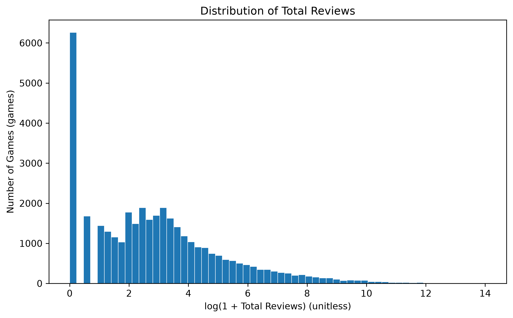

# Introduction
The video game industry has become a major part of the digital entertainment market, with online platforms such as Steam providing developers and publishers access to a global audience. In addition to purchasing and playing games, Steam users can share their experiences and recommend games through reviews (Valve, n.d.). These reviews provide information about player opinions and offer a measurable indicator of audience engagement.

Understanding the factors associated with review volume is important for developers and publishers because reviews can provide insights into player experiences and engagement. Previous research has examined how reviews relate to video game usage and how player engagement modes influence review characteristics (Philp & Nepomuceno, 2024; Guzsvinecz & Szűcs, 2026). In particular, pricing, game genres, available features, and estimated ownership may be associated with differences in the number of reviews received by games. Understanding these relationships could help inform decisions about game positioning and market strategies.

This study investigates the following research question: How well can game price, genres, categories, and estimated owners predict the total number of reviews received by Steam games released between 2018 and 2022?

The analysis uses the Steam Games Dataset published by FronkonGames on Hugging Face (FronkonGames, n.d.). Each row represents an individual Steam game. The dataset includes information such as release date, price, genres, categories, estimated owners, and positive and negative review counts. The study focuses on 43,092 games released between 2018 and 2022. The response variable, total reviews, is calculated by adding the positive and negative review counts. The explanatory variables are price, genres, categories, and estimated owners. These variables provide the information needed to investigate the research question using regression analysis.

In this study, the analysis aims to identify predictive relationships rather than establish causation.

# Methods


# Results
## Exploratory Data Analysis

### Summary Statistics

The training dataset contains 37,487 Steam games.
Descriptive statistics for the numerical variables
are presented in @tbl-training-summary.

```{python}
#| label: tbl-training-summary
#| tbl-cap: "Descriptive statistics of the training dataset"
#| echo: false

import pandas as pd

summary = pd.read_csv(
    "tables/training_summary.csv"
)

from IPython.display import display

display(
    summary.round(2)
)
```

The mean number of reviews (1,158.54) is substantially
higher than the median (14), indicating a strongly
right-skewed distribution.
This motivates the log transformation used in the
exploratory visualization.

The exploratory data analysis was conducted using only the training dataset to avoid data leakage.

### Distribution of Total Reviews

{#fig-review-distribution}

The distribution of total reviews is highly right-skewed. Most games receive relatively few reviews, while a small number of games receive substantially more. Applying the log transformation makes the distribution easier to visualize while retaining games with zero reviews.

### Supported Languages and Review Counts

{#fig-language-reviews}

Games supporting more languages tend to have higher median review counts. This suggests a positive association between language availability and review volume. However, this relationship is descriptive and does not establish causality.
# Discussion

## Real-world implications
The findings provide insights into how selected game characteristics are related to review volume on Steam. For game developers and publishers, understanding these relationships may help them identify characteristics associated with greater audience engagement. However, these relationships should not be interpreted as evidence that a particular characteristic directly causes an increase in reviews.

## Limitations
This study has several limitations. First, estimated ownership is provided as a range rather than an exact number, which may reduce measurement precision. Second, the analysis focuses on four selected predictors and does not account for other factors that may influence review volume, such as marketing activities, game quality, and release timing. The dataset also lacks detailed information about marketing budgets, external advertising reach, and launch strategies, which may affect a game's visibility and the number of reviews it receives. Furthermore, games released in different years have had varying amounts of time to accumulate reviews, which may affect comparisons of review volume.

## Future directions
Future research could investigate additional factors that may influence review volume, such as game ratings, marketing activities, and developer reputation. Researchers could also examine whether the relationships between game characteristics and review counts differ across release years. Finally, comparing linear regression with alternative predictive models could help determine whether more complex methods provide better predictions of Steam game review counts.

# References
FronkonGames. (n.d.). Steam Games Dataset. Hugging Face. https://doi.org/10.57967/hf/0511

Guzsvinecz, T., & Szűcs, J. (2026). Emotions in play: A length and sentiment analysis of Steam reviews by player engagement mode. Heliyon, 12, e45258. https://doi.org/10.1016/j.heliyon.2026.e45258

Philp, M., & Nepomuceno, M. V. (2024). How reviews influence product usage post-purchase: An examination of video game playtime. Journal of Business Research, 172, 114456. https://doi.org/10.1016/j.jbusres.2023.114456

Valve. (n.d.). User reviews. Steamworks Documentation. https://partner.steamgames.com/doc/store/reviews